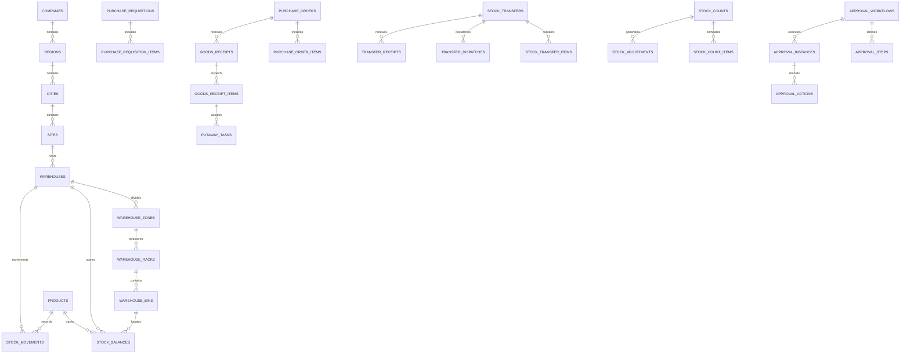

# Enterprise Multi-Location Inventory & Warehouse Management ERP

An enterprise-grade, web-based ERP system designed for managing products, multi-tier warehouse topologies, double-entry stock ledgers, procurement, goods receipts, inter-facility transfers, cycle counts, and configurable approval workflows.

Built strictly according to the **Enterprise ERP Project Specification & Development Brief**.

---

## 1. Architectural Analysis & Approach Evaluation

### 1.1 Evaluated Approaches

| Architecture Approach | Description | Advantages | Limitations | Suitability |
| :--- | :--- | :--- | :--- | :--- |
| **Approach 1: Domain-Driven Modular Monolith** *(Selected)* | Clear domain separation in a unified TypeScript codebase (`frontend/` React SPA + `backend/` Express API + Prisma ORM + PostgreSQL). | • Direct ACID database transactions across stock ledgers and balances<br>• Zero distributed transaction / two-phase commit overhead<br>• Strict end-to-end type safety<br>• Simple local setup and Docker Compose orchestration | Requires disciplined module boundaries to prevent cross-domain coupling. | ⭐ **Most Suitable (100% matches brief)** |
| **Approach 2: Distributed Microservices** | Independent services for Inventory, Warehouse Hierarchy, Procurement, and Approvals communicating via gRPC/RabbitMQ. | Independent scaling of high-throughput inventory services. | High operational complexity, eventual consistency risks on inventory ledgers, distributed transaction (Saga) overhead. | ❌ Excessive complexity for initial enterprise release. |
| **Approach 3: Serverless / BaaS (Next.js / Edge Functions)** | Monolithic serverless functions running on edge / lambda runtimes. | Serverless autoscaling and minimal server maintenance. | Connection pooling constraints with PostgreSQL, cold start latencies, challenging long-running ledger locks. | ❌ Conflicts with the specified Node/Express + React architecture. |
| **Approach 4: Event-Sourced CQRS System** | Raw event stream storage (Kafka/EventStoreDB) with projected read views. | Complete temporal replay of every event in history. | High conceptual complexity, read-model lag can cause overselling or over-allocation during concurrent checks. | ❌ High overhead; relational ledger entries in PostgreSQL achieve equal traceability with immediate consistency. |

### 1.2 Decision: Domain-Driven Modular Monolith
The **Domain-Driven Modular Monolith** was selected because:
1. It precisely implements the mandated stack: **React.js + TypeScript**, **Node.js + Express.js + TypeScript**, **Prisma ORM**, and **PostgreSQL**.
2. It guarantees **atomic database transactions** (`$transaction`) for stock receipts, issues, transfers, and adjustments, eliminating negative stock balances, overselling, or orphaned ledger entries.
3. It keeps shared services (RBAC, Authentication, Audit Trail, Notification, and Reusable Approval Engine) DRY and easily maintainable.

---

## 2. Multi-Tier Warehouse Hierarchy

```
Company (e.g. Apex Global Corp)
  └── Region (e.g. South Region)
        └── City (e.g. Chennai, Bengaluru)
              └── Site/Branch (e.g. Ambattur Industrial Site)
                    └── Warehouse (e.g. Main Logistics Hub)
                          └── Zone (e.g. Zone A - Raw Materials, Zone B - FG, Receiving, Dispatch)
                                └── Rack / Shelf (e.g. Rack A01, Rack A02)
                                      └── Bin (e.g. Bin A01-001, Bin A01-002)
```

- **Configurable Hierarchy**: Supports smaller warehouses that do not use zones or racks (bins can attach directly to warehouses).
- **Integrity Enforcement**: Deletion of locations with historical transactions or active inventory is blocked; deactivation preserves the audit trail.
- **Location Types**: Bins and zones support distinct roles: `RECEIVING`, `STORAGE`, `PICKING`, `QUARANTINE`, `DISPATCH`.

---

## 3. Technology Stack

- **Frontend**: React 18, TypeScript, Vite, Tailwind CSS, TanStack Query (React Query), React Router v6, Lucide Icons.
- **Backend**: Node.js v22, Express.js, TypeScript, Prisma ORM 5.x.
- **Database**: PostgreSQL 15 (relational constraints, foreign keys, unique composite indexes, atomic transactions).
- **Authentication & Security**: JWT tokens, bcrypt password hashing, role-based access control (RBAC), warehouse scoping.
- **API Documentation**: OpenAPI 3.0 / Swagger UI (`/api/docs`).
- **Testing**: Vitest, Supertest integration suite.
- **Containerization**: Docker Compose (`postgres`, `backend`, `frontend`).

---

## 4. Database Schema (12 Entity Groups)



---

## 5. Quick Start Guide

### Option A: Running with Docker Compose (Recommended)

1. Clone or navigate to the project directory:
   ```bash
   cd "Enterprise Inventory & Warehouse Management ERP"
   ```

2. Start all services using Docker Compose:
   ```bash
   docker compose up --build -d
   ```

3. Seed the database with demo enterprise data:
   ```bash
   docker compose exec backend npm run prisma:seed
   ```

4. Access the web applications:
   - **Frontend Application**: [http://localhost:5173](http://localhost:5173)
   - **Backend API & Health**: [http://localhost:5000/api/health](http://localhost:5000/api/health)
   - **Swagger API Docs**: [http://localhost:5000/api/docs](http://localhost:5000/api/docs)

---

### Option B: Running Locally (Node.js & Local PostgreSQL)

#### 1. Backend Setup:
```bash
cd backend
npm install
# Sync PostgreSQL schema
npm run prisma:push
# Seed initial demo data
npm run prisma:seed
# Run automated test suite
npm test
# Start development server
npm run dev
```
Backend runs on `http://localhost:5000`.

#### 2. Frontend Setup:
```bash
cd frontend
npm install
npm run dev
```
Frontend runs on `http://localhost:5173`.

---

## 6. Pre-Configured Demo Accounts

All demo accounts use the standard password: `Password123!`

| Role | Username | Email | Responsibilities |
| :--- | :--- | :--- | :--- |
| **System Administrator** | `admin` | `admin@apexerp.com` | Full root access, user administration, system config. |
| **Inventory Manager** | `inv_manager` | `inventory.manager@apexerp.com` | Valuation, cycle count approvals, ledger inspection. |
| **Warehouse Manager** | `wh_manager` | `warehouse.manager@apexerp.com` | Bin topology, transfer authorizations, receiving oversight. |
| **Warehouse Staff** | `wh_staff` | `warehouse.staff@apexerp.com` | Putaway task execution, picking, count entry. |
| **Procurement Officer**| `proc_officer` | `procurement@apexerp.com` | Requisition creation, RFQs, purchase orders. |
| **Department Head** | `dept_manager` | `dept.head@apexerp.com` | Material requests, requisition submissions. |
| **Finance Approver** | `fin_approver` | `finance@apexerp.com` | Requisition and PO budget review and sign-off. |
| **Auditor** | `auditor` | `auditor@apexerp.com` | Read-only ledger audits and compliance logs. |

*(The frontend includes a **1-Click Persona Switcher** in the top navbar and login page for instant role switching during demonstrations.)*

---

## 7. Traceable Workflow Walkthrough

### 1. Purchase-to-Stock Lifecycle
1. **Purchase Requisition**: Department Head submits a requisition (`PR-2026-0001`).
2. **Approval Workflow**: Requisition enters the Approval Inbox for Department Head and Finance review.
3. **Purchase Order**: Procurement generates an authorized PO to a qualified supplier.
4. **Goods Receipt (GRN)**: Receiving inspects delivered quantities, distinguishing accepted, damaged, and rejected goods.
5. **Putaway Task**: Warehouse staff assigns accepted stock to a specific bin (`BIN-A01-001`). Upon confirmation, an atomic `RECEIPT` transaction is posted to the stock ledger and available stock is incremented.

### 2. Inter-Facility Transfer with Discrepancy Tracking
1. Transfer requested from Ambattur Hub (`WH-AMB-01`) to Whitefield Distribution (`WH-WHF-01`).
2. Source inventory is validated and approved.
3. **Dispatch**: Carrier details and tracking are attached; stock is deducted from source and marked `IN_TRANSIT`.
4. **Destination Receipt**: Actual received physical units are checked. If dispatched is 50 but received is 49, a shortage discrepancy of 1 unit is recorded in the ledger rather than silently lost.

### 3. Physical Stock Count & Variance Reconciliation
1. Warehouse initiates a **Cycle Count** session for a specific zone or rack.
2. System snapshots current system quantities.
3. Staff enters physical counted quantities.
4. System calculates variances (e.g., `+5 Surplus` or `-2 Damage`).
5. Upon approval, `ADJUSTMENT_UP` or `ADJUSTMENT_DOWN` transactions are posted directly to the stock ledger, bringing physical and system counts into 100% agreement.

---

## 8. Automated Test Suite

Run the Vitest test suite in the backend folder:
```bash
cd backend
npm test
```

### Verified Test Cases:
- ✔ User authentication and JWT verification
- ✔ Role-based access control (RBAC) and forbidden action rejection
- ✔ Multi-tier warehouse hierarchy tree generation
- ✔ Duplicate SKU and warehouse code prevention (unique constraint check)
- ✔ Controlled intake posting atomically to immutable ledger
- ✔ Available stock formula: `onHand - reserved - damaged - quarantined`
- ✔ Transfer over-allocation prevention (insufficient stock rejection)
- ✔ Complete transfer lifecycle: Create → Dispatch (Transit) → Receive with discrepancy
- ✔ Material consumption concurrency protection
- ✔ Reusable Approval Engine: PR submission and approval sign-off
- ✔ Executive valuation and stock summary aggregation
